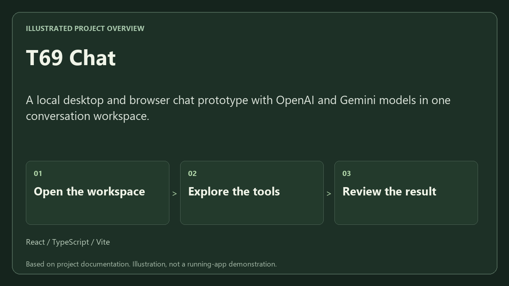
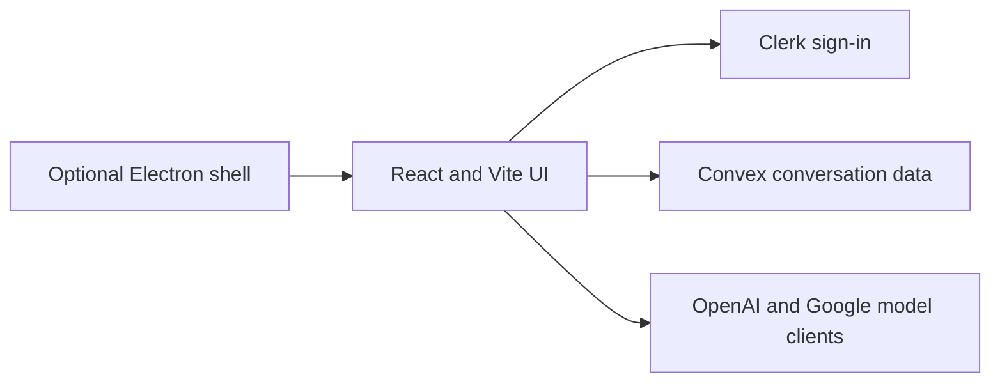

# T69 Chat

I wanted one place to try different model clients without splitting the experiment across apps. T69 Chat brings OpenAI and Google model choices together with Markdown/code/math rendering, optional Clerk sign-in, Convex conversation storage, and an Electron shell. It’s a local prototype with configuration still required; fork it, swap in a provider, and share what makes model comparisons useful to you.

*Click preview above to watch illustrated architecture overview.*

## Preview

The repository does not currently include a verified application screenshot. See the [setup notes](SETUP.md) and [demo setup](DEMO_SETUP.md) before running the prototype.

## Features

- Chat UI for the provider/model choices wired into this version.
- Conversation persistence through Convex when configured.
- Optional Clerk sign-in.
- Browser development through Vite and a desktop shell through Electron.
- Markdown, code, and math rendering in assistant messages.

## Run locally

1. Install Node.js and npm.
2. Install dependencies: `npm install`.
3. Follow [SETUP.md](SETUP.md) for the environment keys this snapshot expects. Configure Clerk and Convex using [CLERK_SETUP.md](CLERK_SETUP.md) and [CONVEX_INTEGRATION.md](CONVEX_INTEGRATION.md).
4. Start the Vite frontend with `npm run dev`. Run `npx convex dev` in a separate terminal when using Convex-backed features.
5. For Electron, see the `electron` script in `package.json` and the desktop setup notes.

Available scripts include `npm run build`, `npm run lint`, and `npm run preview`.

## Architecture

Provider credentials and backend configuration are intended for local development. Do not deploy this snapshot with browser-exposed provider secrets. Check provider availability and model names in the source before use; older setup notes may reference model versions that have since changed.

## Project status

This is a development prototype, not a production hosted chat service. Configuration, authentication, provider access, and storage must be set up independently. The previous README has been retained at [docs/README-reference.md](docs/README-reference.md) for historical setup context.
