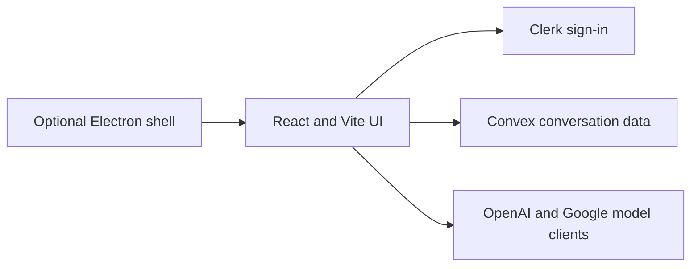

# T69 Chat

A desktop and browser chat prototype that puts OpenAI and Google Gemini models in one conversation workspace.

## Try it locally

Follow the quick start below to configure your own model credentials. See the [Clerk setup](CLERK_SETUP.md) and [Convex integration](CONVEX_INTEGRATION.md) when testing authentication and storage. Start a new chat, choose a model, and compare how providers handle the same prompt.

This is a local development prototype. A public deployment needs server-side handling of model API credentials.

A modern, multi-LLM chat interface built with React, TypeScript, and Material-UI. Chat with different AI models including OpenAI's GPT and Google's Gemini models in real-time.


## ✨ Features

- 🎯 **Multiple LLM Support** - Switch between OpenAI GPT-4o, GPT-4o Mini, and Google Gemini models
- ⚡ **Real-time Streaming** - See responses appear as they're being generated
- 🔐 **Secure Authentication** - User management powered by Clerk
- 🗄️ **Cloud Database** - Persistent conversations stored in Convex with real-time sync
- 🎨 **Modern Dark UI** - Beautiful, responsive design with Material-UI components
- 💬 **Multiple Conversations** - Create unlimited chat sessions per user with smart organization
- 🔄 **Model Switching** - Change AI models mid-conversation
- 👤 **Personalized Experience** - User profiles and personalized welcome messages
- 📱 **Responsive Design** - Works perfectly on desktop and mobile
- 🔍 **Search & Organization** - Find conversations easily with search and date grouping
- ⚡ **Real-time Sync** - Conversations sync instantly across devices and tabs

## 🚀 Quick Start

### Prerequisites

- Node.js 18+ 
- npm or yarn
- API keys for OpenAI and/or Google AI

### Installation

1. **Clone and navigate to the project:**
   ```bash
   cd t69-chat
   ```

2. **Install dependencies:**
   ```bash
   npm install
   ```

3. **Set up environment variables:**
   ```bash
   cp .env.example .env
   ```
   
   Edit `.env` and add your API keys:
   ```env
   VITE_OPENAI_API_KEY=your_openai_api_key_here
   VITE_GOOGLE_API_KEY=your_google_api_key_here
   VITE_CLERK_PUBLISHABLE_KEY=your_clerk_publishable_key_here
   ```

4. **Set up Convex database:**
   ```bash
   npx convex dev --configure
   ```
   This will create your Convex project and add the database URL to `.env.local`

5. **Start the development servers:**
   ```bash
   # Terminal 1: Start Convex dev server
   npx convex dev
   
   # Terminal 2: Start Vite dev server
   npm run dev
   ```

5. **Open your browser:**
   Visit `http://localhost:5173` (or the port shown in your terminal)

## 🔑 Getting API Keys

### OpenAI API Key
1. Visit [OpenAI Platform](https://platform.openai.com/api-keys)
2. Sign in or create an account
3. Create a new API key
4. Copy the key to your `.env` file

### Google AI API Key
1. Visit [Google AI Studio](https://makersuite.google.com/app/apikey)
2. Sign in with your Google account
3. Create a new API key
4. Copy the key to your `.env` file

### Clerk Authentication Key
1. Visit [Clerk.com](https://clerk.com) and create an account
2. Create a new application
3. Go to "API Keys" in your dashboard
4. Copy your **Publishable Key**
5. Add it to your `.env` file

For detailed Clerk setup instructions, see [CLERK_SETUP.md](./CLERK_SETUP.md)

## 🤖 Available Models

| Model | Provider | Description |
|-------|----------|-------------|
| **GPT-4o** | OpenAI | Latest flagship model with enhanced reasoning |
| **GPT-4o Mini** | OpenAI | Faster, cost-effective version of GPT-4o |
| **Gemini 2.0 Flash** | Google | Latest experimental model with fast responses |
| **Gemini 1.5 Flash** | Google | Production-ready model with excellent performance |

## 🛠️ Development

### Available Scripts

- `npm run dev` - Start development server
- `npm run build` - Build for production
- `npm run preview` - Preview production build
- `npm run lint` - Run ESLint

### Tech Stack

- **Frontend**: React 18 + TypeScript + Vite
- **UI Library**: Material-UI (MUI) 5
- **Authentication**: Clerk
- **Database**: Convex (real-time, serverless)
- **AI APIs**: OpenAI + Google Generative AI
- **Styling**: Material-UI + Custom CSS
- **Build Tool**: Vite 6

### Project Structure

```
src/
├── components/          # Reusable UI components
│   ├── chat/           # Chat-specific components
│   └── layout/         # Layout components
├── context/            # React context providers
├── pages/              # Main page components
├── services/           # API and external services
├── styles/             # Styling and themes
└── types/              # TypeScript type definitions
```

## 🔒 Security Note

⚠️ **Important**: This application uses API keys in the browser (client-side) for demo purposes. For production use, implement a backend proxy to keep API keys secure.

## 🤝 Contributing

1. Fork the repository
2. Create your feature branch (`git checkout -b feature/amazing-feature`)
3. Commit your changes (`git commit -m 'Add some amazing feature'`)
4. Push to the branch (`git push origin feature/amazing-feature`)
5. Open a Pull Request

## 📄 License

This project is licensed under the MIT License - see the [LICENSE](LICENSE) file for details.

## 🙏 Acknowledgments

- [OpenAI](https://openai.com/) for GPT models
- [Google AI](https://ai.google/) for Gemini models
- [Material-UI](https://mui.com/) for the component library
- [Vite](https://vitejs.dev/) for the build tool
- [React](https://reactjs.org/) for the UI framework

---

**Built with ❤️ using React, TypeScript, and modern web technologies**

## Architecture



Provider keys and Clerk/Convex values must match [SETUP.md](SETUP.md), [CLERK_SETUP.md](CLERK_SETUP.md), and [CONVEX_INTEGRATION.md](CONVEX_INTEGRATION.md). The setup guides are the source of truth for current configuration.
